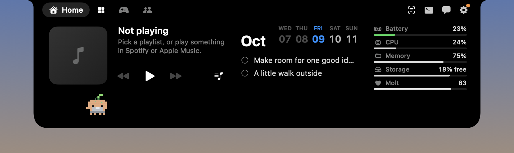
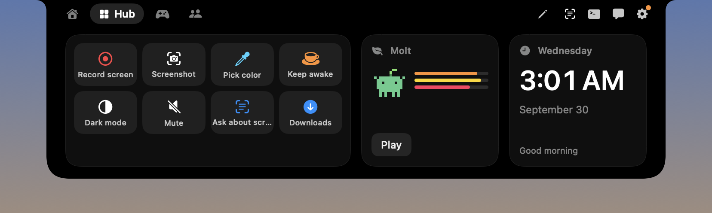
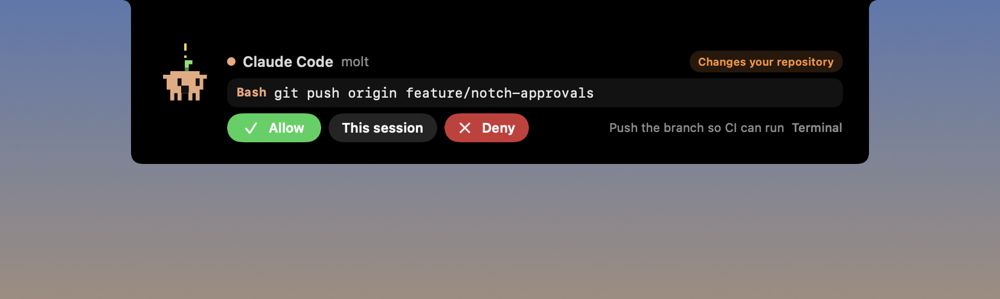
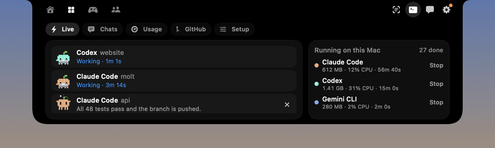
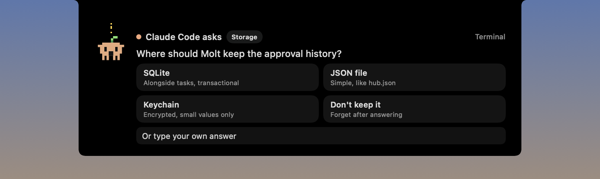
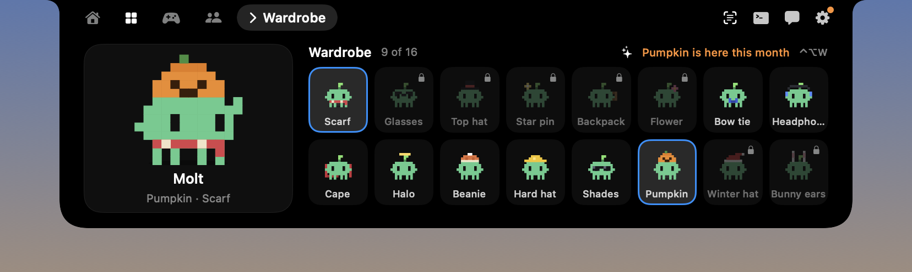
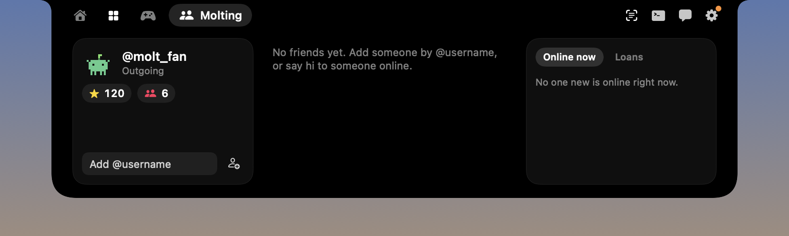

# Molt

A little companion that lives in your MacBook's notch.

Molt is a native macOS notch app. Hover over the notch and it opens into a black panel that looks like part of the hardware: your music, your week, your Mac's health, your own widgets, your coding agents, and Molt, a small pixel creature that runs around when you look after it, sits at its laptop while your agents work, and hangs out with your friends' Molts.



Molt is drawn pixel by pixel, and it moves like it's alive: it breathes, squashes when it lands, follows your pointer with its eyes, blinks at its own pace, blushes when you pat it, and gives off little pixel sparkles, hearts and z's. Click it to say hi.

## Getting started

Open Molt and create your account once: email, password and a @username. You stay signed in on that Mac. Turn on two-factor authentication in Settings; until you do, Molt sends a gentle weekly reminder.

Hover over the notch, or press **⌘⇧↩**, to open Molt. **⌘⇧L** asks about anything on your screen. Every page is the same size. Home, Hub, Play and Molting sit left of the notch; Lens, Agents, Chat and Settings are icons on the right.

| Shortcut | Opens |
| --- | --- |
| ⌘⇧↩ | Molt |
| ⌘⇧L | Lens |
| ⌃⌥C · ⌃⌥A · ⌃⌥U · ⌃⌥G | Chat · Agents · Plan usage · GitHub |
| ⌃⌥W · ⌃⌥H | Wardrobe · Hub |
| ⌃⌥Y · ⌃⌥N | Allow or deny the waiting approval |

With VoiceOver on, the Control-Option shortcuts add Command (⌃⌥⌘), since Control-Option is VoiceOver's own key.

## Pages

- **Home:** now playing, a five-day calendar strip with today's events or tasks, and Mac health. Click the health column to see what's using your Mac. Molt scurries along the bottom, or sleeps.
- **Hub:** four slots of widgets you choose, like a Home Screen. See [Widgets](#widgets).
- **Play:** a tamagotchi. Drag a meal, snack, water, ball, nap, brush, pat or story onto Molt, or click it. The more you care for Molt, the livelier it gets. **Wardrobe** dresses Molt up; see [Wardrobe](#wardrobe).
- **Molting:** friends, hangouts and lending your setup. See [Molting](#molting).
- **Lens:** select part of your screen and ask about it.
- **Agents:** what Claude Code, Codex and other agents are doing, approvals, your chats with them, plan limits and GitHub. See [Agents](#agents).
- **Chat:** talk to Molt with Ollama or LM Studio on this Mac, or with Anthropic, OpenAI, Google or OpenRouter using your own key.
- **Settings:** your account and 2FA, Molt's name and color, accent, hover, display, and every connection.



## Widgets

Click the pencil in the header, or hold any widget, to edit the Hub. Widgets jiggle; drag to reorder, **–** removes, the arrows switch between small and wide, and **+** adds from the catalog.

| Widget | Sizes | What it does |
| --- | --- | --- |
| Shortcuts | small, wide | 4 or 8 one-click actions you pick: record screen, screenshot, ask about screen, pick a color, keep awake, dark mode, mute, sleep screen, Downloads, empty Trash, focus, System Settings, any app, any Apple Shortcut, or any link |
| Screen recorder | small | Records the screen with one click; saves to Movies. While recording, a red dot and timer sit beside the notch; click them to stop |
| Lens | small | Ask about your screen |
| Focus, Tasks, Weather | small (Tasks also wide) | Focus timer, today's to-dos, your city's weather |
| Top apps | small, wide | Your most-used apps today, with their icons |
| Molt | small | Molt's needs at a glance |
| Agent usage | small | Today's Claude Code and Codex tokens |
| Agents | small | Who's working and who needs you |
| Plan usage | small, wide | Claude and Codex 5-hour and weekly limits, with a forecast |
| GitHub | small, wide | Your streak, PRs, reviews waiting and default-branch checks |
| Your week | wide | Agent tokens, tasks done and your streak, in a card you can share |
| Up next | small, wide | Your next events with a countdown |
| Mac health | small | Opens the health drill-down |
| Now playing, Playlists | small/wide, wide | Music controls and playlist covers |
| Clock, Downloads, Quick note, Web search | various | Time, latest downloads, a scratchpad, and search across Google, YouTube, Wikipedia and Maps |

## Lens

Press **⌘⇧L** (or the viewfinder icon) and drag over text, an image, an error or a QR code. macOS's built-in Vision reads the text, recognizes objects and scans codes on your Mac; the model you chose answers questions using that (pick a separate Lens model in Settings). There's no vision model to download and no image is uploaded. Quick actions: What is this?, Explain it, Summarize, Translate, Copy text, **Send to agent** (copies what Lens read as a prompt and brings your terminal forward), Search web.

## Agents



Open **Agents › Setup** and choose **Connect** for Claude Code and Codex.

- **Approvals in the notch:** when Claude Code wants to run a command or edit a file, Molt drops down with what it wants to do, how risky it looks and the agent's reason. For edits you see the **diff** first: the lines it would remove and add, or the whole file if it's new. **Allow**, **This session**, **Deny**, or hand it back to the **Terminal**. If you're already in your terminal, it asks you there instead (you can turn that off).
- **Questions:** when Claude Code asks you to choose (its multiple-choice questions), the options appear as buttons in the notch. Pick one, pick several, or type your own answer; questions with several parts go one at a time.
- **Habits:** allow the same safe thing three times and Molt offers to always allow it. Risky commands (deleting recursively, force-pushing, `sudo`, piping downloads into a shell) always ask. Rules live in **Agents › Setup**.
- **Status:** with the notch closed, Molt sits at its laptop in the agent's color while it works and pops up a **!** when it needs you. Long tasks end with a "finished" note; finished notes wait while you're in a focus session.
- **Live:** every session with its project and timer, plus the agents running on this Mac (Claude Code, Codex, Gemini CLI, Cursor Agent, OpenCode, Amp, Copilot CLI, Aider, Goose) with memory, CPU and uptime, and a **Stop** button.
- **Chats:** your conversations with token counts and private copies. The **±** button lists the files the agent changed in that conversation with what's still uncommitted, and shows the diff.
- **Usage:** your 5-hour and weekly limits. Codex's come from its own logs. Claude's are off until you choose **Show Claude limits**; Molt then reads Claude Code's sign-in from your keychain (macOS asks first) and asks Anthropic, the same way Claude Code's `/usage` does. Each bar shows where an even pace would be and when you'd run out at today's pace.
- **GitHub:** your contribution streak, your open pull requests with their checks, reviews waiting on you (older than a day in orange), and the default branch of the repository you last worked in. Molt signs in with the GitHub CLI (`gh auth login`) or a token you paste. When the default branch turns red, Molt worries and tells you.





Molt adds HTTP hooks to `~/.claude/settings.json` (including one on `PreToolUse` that only matches `AskUserQuestion`, so other tools never wait on Molt) (keeping a one-time `settings.json.before-molt` backup and every other setting) and points Codex's `notify` at a small script, keeping any notify program you already had. Both talk only to `127.0.0.1:43822` with a random token. When Molt isn't running, the agents ask in the terminal as usual. **Disconnect** removes only Molt's parts.

## Wardrobe



Sixteen pixel items in four slots (head, face, neck, back), one per slot. You earn them by caring for Molt, reaching friend points in Hangouts, finishing agent tasks and keeping a GitHub streak. Seasonal items (a pumpkin in October, a winter hat in December, bunny ears in April) are yours to keep if you collect them that month. Lending your setup lends your outfit too.

### If Lens can't see your screen

Lens needs **Screen Recording** (System Settings › Privacy & Security › Screen & System Audio Recording). macOS applies it only after Molt relaunches, and it ties the permission to the exact build, so after an update an old "on" switch can stop working. Lens shows **Open Settings**, **Relaunch Molt** and **Reset permission** (clears the old switch so macOS asks again).

You can always skip the permission: press **⌃⌘⇧4**, select an area (macOS copies it), then choose **Paste screenshot** in Lens, or drop an image onto Lens.

If you build Molt yourself, run `./scripts/make-signing-cert.sh` once. Builds are then signed with the same local identity, and macOS keeps the permission across updates.

## Mac health

Click the health column on Home, or the Mac health widget:

- **CPU / Memory:** the apps using the most, with helper processes grouped under their app. Quit a background app after a confirmation. System processes, Finder and Molt can't be quit from here.
- **Battery:** health, cycle count, temperature, power source and time remaining.
- **Storage:** measures Trash, Downloads, Desktop, Documents, Movies, app caches, Xcode build data and simulators.
- **Molt's advice:** one suggestion at a time, like quitting the background app eating memory, emptying a large Trash, or clearing Xcode build data (moved to the Trash, so it's recoverable). **Low-impact Molt** stops Molt's own animations.

## Molting

- **Friends:** add people by @username, or from **Online now**. Accept or decline requests.
- **Hangouts:** invite an online friend. Both Molts appear in a little playground; click to walk, and send waves, hearts, dances and laughs. When you leave, you both earn points (10 plus 2 per minute, up to 50) and your social status goes up, after at least a minute together and once an hour per friend.
- **Lending:** lend your Hub widgets, accent color, Molt's color and outfit to a friend for a day, a week, or until they give it back. They can try it on; their own setup comes back when the loan ends.
- **What you're up to:** turn on **Show friends which agent I'm using** in Agents › Setup and online friends see "Coding with Claude Code" under your name.
- Turn off **Show me in Online now** in your account to stay invisible to strangers.



## Music

Home follows whichever of Spotify or Apple Music is playing, with artwork, a draggable progress bar and playback controls. Click the artwork to browse your playlists; clicking one plays it in the background without opening the app.

- **Apple Music:** choose **Connect Apple Music** to read the playlists in your library.
- **Spotify:** create a free app at [developer.spotify.com/dashboard](https://developer.spotify.com/dashboard), add `http://127.0.0.1:43821/callback` as its redirect URI, paste its Client ID into Molt and choose **Connect**. With Spotify connected, Home also follows and controls Spotify playing on other devices (needs Premium).

## Run and package

Requires macOS 13+, Swift 5.9+, and full Xcode for universal builds and XCTest.

```sh
swift run Molt
DEVELOPER_DIR=/Applications/Xcode.app/Contents/Developer swift test --scratch-path .build-xcode
DEVELOPER_DIR=/Applications/Xcode.app/Contents/Developer ./scripts/package.sh 0.9.1
open dist/Molt.app
```

The package script produces `dist/Molt-0.9.1.dmg` and an ad-hoc signed universal app. Ad-hoc signing is not Apple notarization.

The backend is a Supabase project; its schema and security rules are in [`supabase/migrations`](supabase/migrations). The app ships only the publishable key; row-level security decides what each signed-in user can read and write.

## Privacy and permissions

- **Account:** your email, @username, Molt's name and color, points and friends are stored on Molt's server. Other signed-in users can see your @username, Molt and points. Your session is kept in the macOS keychain.
- **Hangouts** send only your Molt's position and emotes, live, to the friend you're with. Nothing from a hangout is stored except its start, end and points.
- **Lens and screen recording** need Screen Recording permission. Lens reads only the area you select, on your Mac. Recordings are saved to Movies and go nowhere else.
- Calendar, app usage, Mac health, and Claude Code & Codex reading are each off until you turn them on. Chat copies stay in `~/Library/Application Support/Molt/Sessions`.
- **Agents** talk to Molt only over `127.0.0.1`, with a random token. Approval details and agent messages stay on your Mac.
- **Claude limits** are off until you turn them on. Molt then reads Claude Code's sign-in token from your keychain each time it checks, sends it only to `api.anthropic.com`, and never stores it.
- **GitHub** uses the GitHub CLI's sign-in or a token you paste (kept in the keychain) and talks only to `api.github.com`.
- **Chat** with Ollama or LM Studio stays on your Mac. If you choose Anthropic, OpenAI, Google or OpenRouter, your messages (and anything you attach) go to that service with your key, which is kept in the keychain. Lens never sends images.
- **Sharing what you're working on** with friends is off until you turn it on, and sends only the agent's name.
- Weather sends only your city search to [Open-Meteo](https://open-meteo.com/) (CC BY 4.0). Spotify tokens stay in the keychain.
- No keystroke recording, clipboard collection or background screen capture.

## Development references

- [Architecture](docs/architecture.md)
- [Companion definitions](docs/definitions.md)
- [0.9.1 release notes](docs/releases/0.9.1.md)
